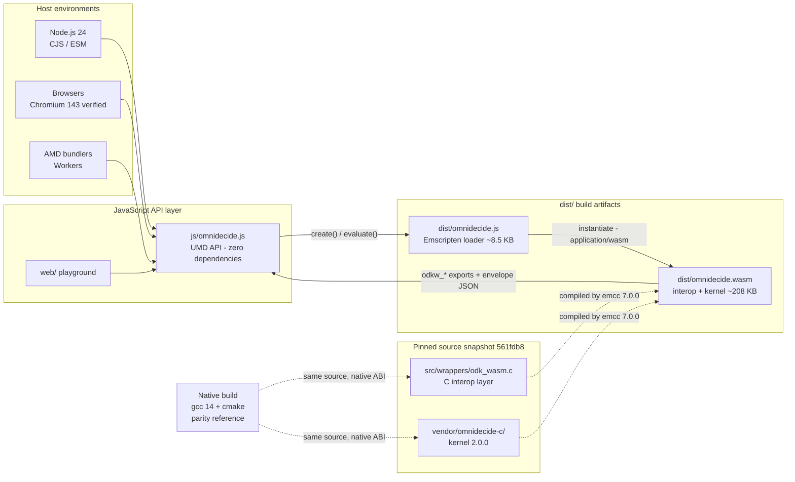
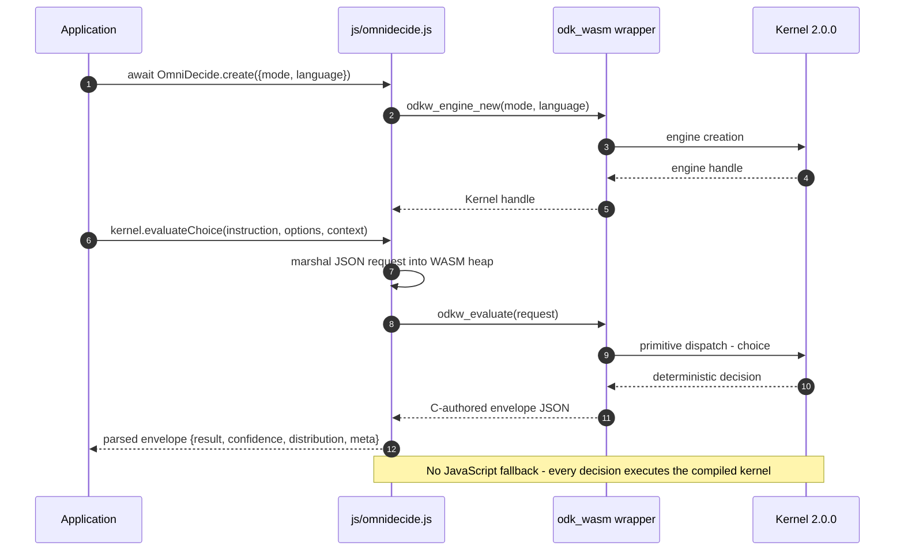
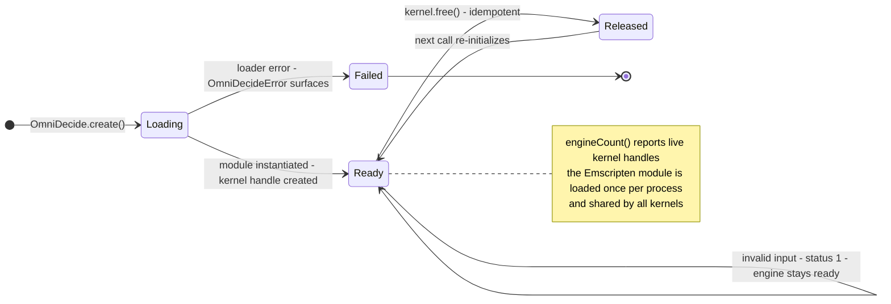
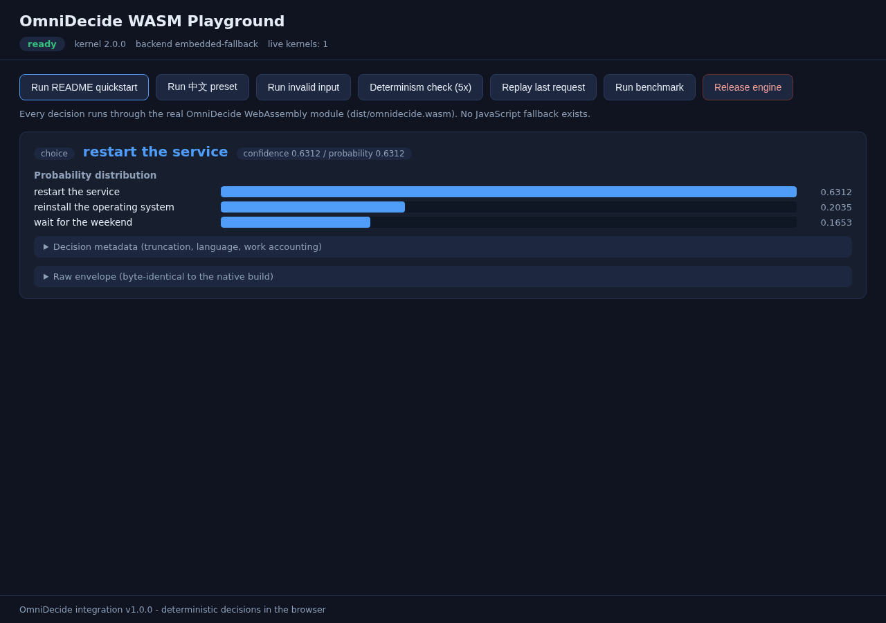
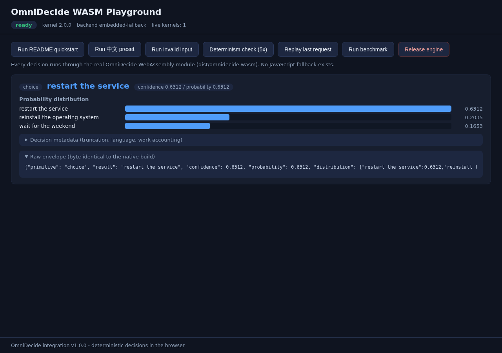
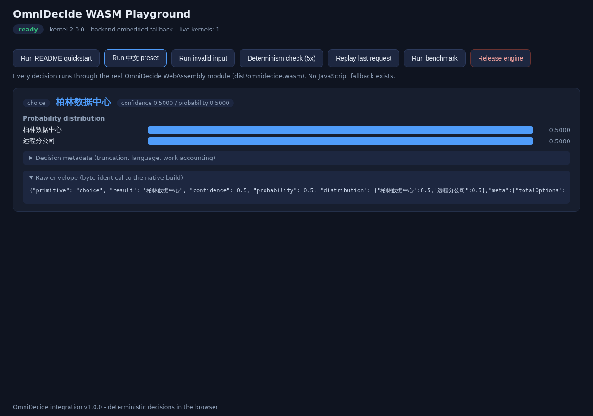
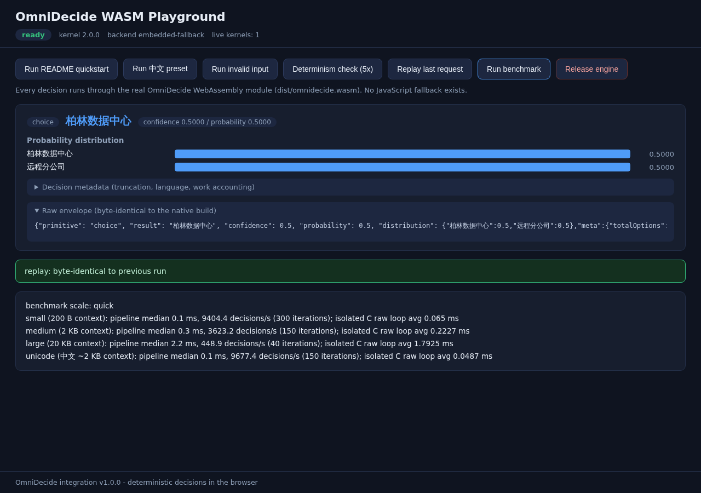
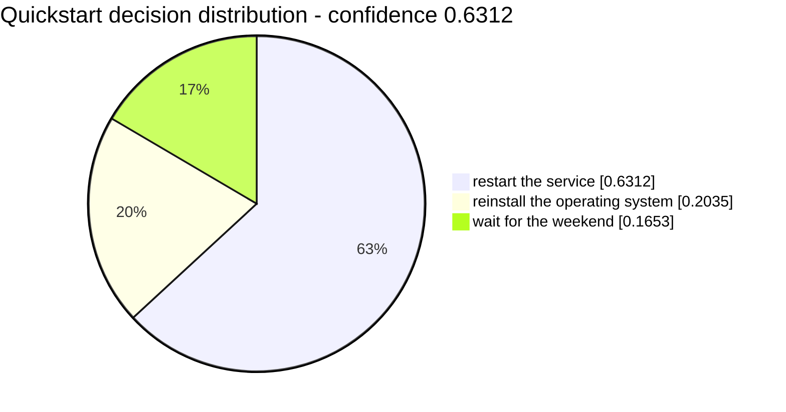
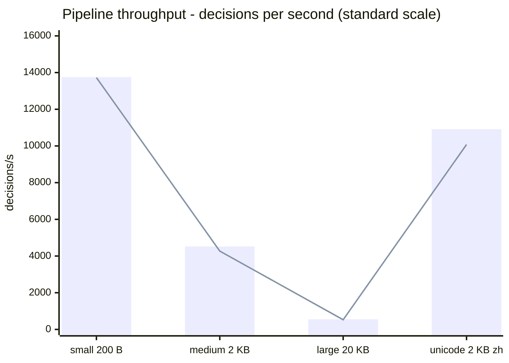
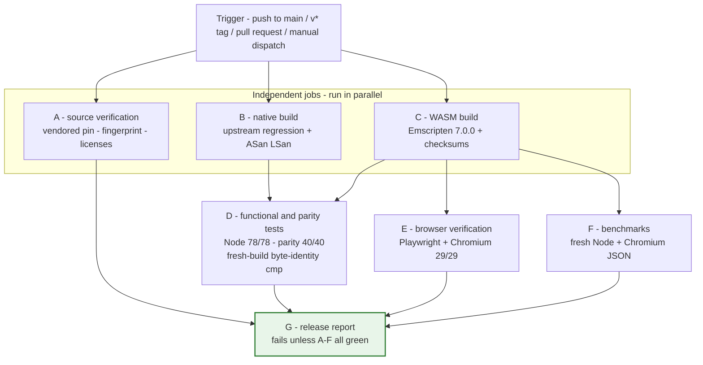

<!-- SPDX-License-Identifier: Apache-2.0 -->
<!-- SPDX-FileCopyrightText: 2026 Tamer Osman -->

<div align="center">

# OmniDecide WASM

**Deterministic decisions in the browser and in Node.js — the OmniDecide
C kernel (2.0.0) compiled to WebAssembly, behind a small C interop layer
and a dependency-free JavaScript API.**

[](CHANGELOG.md)
[](docs/WASM-STATUS.md)
[](docs/VERIFICATION-1.0.0.md)
[](LICENSE)
[](docs/COMPATIBILITY.md)
[](docs/BUILDING.md)

<!-- After the first push to GitHub you can enable the live CI badge:
[](https://github.com/OWNER/REPO/actions/workflows/ci.yml)
-->

</div>

---

## Table of contents

1. [What is this?](#what-is-this)
2. [At a glance](#at-a-glance)
3. [Architecture](#architecture)
4. [Anatomy of a decision](#anatomy-of-a-decision)
5. [Kernel lifecycle](#kernel-lifecycle)
6. [The six primitives](#the-six-primitives)
7. [Languages and text modes](#languages-and-text-modes)
8. [Quick start](#quick-start)
9. [Browser playground](#browser-playground)
10. [Determinism and parity](#determinism-and-parity)
11. [Benchmarks](#benchmarks)
12. [CI release pipeline](#ci-release-pipeline)
13. [Provenance and supply chain](#provenance-and-supply-chain)
14. [Security and error model](#security-and-error-model)
15. [Compatibility](#compatibility)
16. [Repository layout](#repository-layout)
17. [Documentation](#documentation)
18. [Contributing](#contributing)
19. [License](#license)

## What is this?

OmniDecide WASM packages the [OmniDecide C kernel](https://github.com/tamer4osman/omnidecide-c)
(v2.0.0, exact pinned snapshot vendored at `vendor/omnidecide-c/`) as a
WebAssembly module so the **same compiled decision engine** runs
unmodified in Node.js services, browser applications and bundler-based
projects. A thin C interop layer (`src/wrappers/odk_wasm.c`) exposes
exactly six decision primitives, and a zero-dependency UMD JavaScript
API (`js/omnidecide.js`) makes them ergonomic from any JavaScript host.

**Decideverse** — the browser laboratory that turns this kernel into a
collection of playable decision games — is built on top of this
foundation and lives in [`gamelab/`](gamelab/README.md).

It is a **generic WebAssembly binding**: no downstream-specific product
logic, no dashboard, no telemetry — any host embeds it and gets the
kernel's deterministic behavior.

Three properties define the project:

- **No simulation.** Every decision is produced by the real C kernel in
  WebAssembly. There is no JavaScript fallback, no mock, no cached
  answer — if the WASM module cannot load, initialization fails loudly.
- **Byte-identical determinism.** Identical inputs produce
  byte-identical decision envelopes on every host. Native and WASM
  builds of the same pinned source are compared envelope-for-envelope on
  every release: 40/40 byte-identical, no field excluded, no tolerance.
- **Self-contained provenance.** The kernel source ships inside this
  repository, pinned to snapshot commit
  `561fdb8ae43a4610d3df92cde5ba0a0ac5f63393` and verified by a
  content-sensitive manifest fingerprint on every build. Clean checkouts
  build offline.

## At a glance

| | |
|---|---|
| Integration version | **1.0.0** (first public release) |
| Kernel | omnidecide-c **2.0.0**, pinned vendored snapshot |
| Artifacts | `dist/omnidecide.wasm` 212,763 B · `dist/omnidecide.js` loader 8,725 B |
| JS API | UMD (Node CJS/ESM, AMD, browser globals) — **zero dependencies** |
| Decision primitives | choice · score · noul · rank · compare · extract |
| Languages | en, zh, hi, es, ar, fr, bn, pt, id, ur + `auto`/`und` |
| License | Apache-2.0 (same as upstream) |
| Toolchain | Emscripten 7.0.0 · Node 24 · Playwright 1.57.0 · Chromium 143 |
| CI | Seven-job GitHub Actions release pipeline (`.github/workflows/ci.yml`) |

## Architecture



The vendored tree is **never modified**. WASM-specific concerns live in
the interop wrapper and the build scripts; the kernel code is upstream
verbatim, verified before every build by `fetch-kernel.sh`. The native
build of the same sources exists purely as the parity reference the
verification suites compare against.

## Anatomy of a decision



A failed evaluation does not produce a silent fallback either — the
wrapper composes a C-authored error envelope, and the JavaScript layer
throws `OmniDecideError` carrying `status`, a deterministic message and
the raw envelope on `e.envelope`.

## Kernel lifecycle



Initialization failure is handled explicitly: when the module cannot
load (for example, a blocked `.wasm` request), the playground surfaces
an error state and renders **no decision** — verified by a dedicated
browser acceptance check that blocks WASM and asserts no silent
fallback.

## The six primitives

Exactly six decision primitives are exposed — nothing more. Unknown
primitives are rejected wrapper-side.

| Primitive | Purpose | Convenience call |
|---|---|---|
| `choice` | pick one option from N | `kernel.evaluateChoice(instruction, options, context, opts?)` |
| `score` | score each rubric item | `kernel.evaluateScore(instruction, rubric, context, opts?)` |
| `noul` | nullness / statement test | `kernel.evaluateNoul(statement, context, opts?)` |
| `rank` | order N options | `kernel.evaluateRank(instruction, options, context, opts?)` |
| `compare` | compare exactly two options | `kernel.evaluateCompare(instruction, options, context, opts?)` |
| `extract` | extract top-K items | `kernel.evaluateExtract(instruction, context, topK, opts?)` |

Output caps (`caps: { maxRanked, maxSnippetChars, maxTotalChars }`) and
the optional accounting block (`meta: true`) **never alter a numeric
decision** — an upstream guarantee the integration preserves verbatim.

## Languages and text modes

| Mode | Accounting | Intended for |
|---|---|---|
| `ascii` (default) | byte-limited | Latin-script content |
| `unicode` | code-point accounting, code-point-boundary truncation | non-Latin languages |

Language codes follow upstream `odk_languages.def`:

| | | | |
|---|---|---|---|
| `en` | `zh` | `hi` | `es` |
| `ar` | `fr` | `bn` | `pt` |
| `id` | `ur` | `auto` (deterministic detection) | `und` (baseline) |

Every language decision in the parity corpus matches the native build
byte-for-byte, including 中文 content in `unicode` mode.

> **Why you will see non-English text in this repository.** The 中文
> playground preset, the multilingual screenshots, the zh/ar/hi
> acceptance cases in the Node suite and native smoke test, and the
> Unicode benchmark workload are **intentional feature demonstrations,
> not stray localization**: multi-language support is a
> release-verified kernel capability, and these fixtures are its proof.
> Each of those decisions runs through the same WASM module and is
> byte-identical to the native build (`tests/parity_check.mjs`, 40/40).

## Quick start

```bash
# 1. Rebuild dist/ (needs Emscripten — see docs/BUILDING.md)
./build.sh

# 2. One-line smoke: create a kernel and print the kernel version
node -e "require('./js/omnidecide.js').OmniDecide.create().then(k => console.log(k.kernelVersion))"

# 3. Full Node functional suite (78 checks)
node tests/omnidecide.test.mjs

# 4. Native/WASM byte-identity parity over the 40-case corpus
./build-native.sh --asan        # native build + tests + leak pass (needs cmake)
node tests/parity_check.mjs

# 5. Browser acceptance (Playwright + Chromium, 29 checks, fresh screenshots)
cd tests && npm ci && npx playwright install --with-deps chromium
cd .. && node tests/browser_check.mjs

# 6. Benchmarks (fresh JSON into docs/benchmarks/)
node tests/node_bench.mjs --scale standard
node tests/browser_bench.mjs --scale standard

# Everything above, one command, from a clean checkout
./scripts/verify-release.sh
```

### First decision in Node

```js
const OmniDecide = require('js/omnidecide.js');

const kernel = await OmniDecide.create({ mode: 'ascii', language: 'und' });
const choice = await kernel.evaluateChoice(
    'How should we fix the outage?',
    ['restart the service', 'reinstall the operating system', 'wait for the weekend'],
    'The service stopped responding. Restarting the service restored ' +
    'normal operation within seconds.');

choice.result;       // "restart the service"
choice.confidence;   // 0.6312
choice.distribution; // { "restart the service": 0.6312, ... }
```

In the browser, include `dist/omnidecide.js` **before**
`js/omnidecide.js` and use the same API via `window.OmniDecide`.
Serve pages over HTTP(S) — `file://` is not supported.

## Browser playground

`web/index.html` is a self-contained playground that exercises the
engine exactly like the acceptance suite does: README quickstart, 中文
preset, invalid-input handling, 5× determinism check, byte-identical
replay, in-page benchmark and engine release. Run it through any static
file server (for example `python3 -m http.server`) and open
`http://127.0.0.1:8000/web/index.html`.

The screenshots below are **fresh captures from the browser acceptance
run of this release** (`node tests/browser_check.mjs` — 29/29 checks).

### README quickstart — decision and probability distribution

The preset fires the exact quickstart call from the README and renders
the decision, the three-bar probability distribution and the collapsible
metadata blocks.



### Raw envelope — byte-identical to the native build

Expanding the raw-envelope block shows the actual C-authored JSON —
the same bytes the native parity runner produces for the same request.



### Unicode preset — 中文 decision in Unicode mode

The 中文 preset runs a Chinese decision through the same WASM module in
`unicode` mode; the envelope is byte-identical to the native build.



### In-page benchmark and byte-identical replay

The benchmark card reports pipeline median and throughput per workload
plus the isolated C timing, and the replay banner confirms the envelope
is byte-identical to the previous run.



## Determinism and parity

The quickstart decision above distributes probability as follows —
identical bytes on every host:



Verification gates behind this claim (fresh runs recorded for this
release in `docs/VERIFICATION-1.0.0.md`):

| Gate | Result |
|---|---|
| Native ↔ WASM envelope parity (`tests/parity_check.mjs`, 40-case corpus) | **40/40 byte-identical**, 0 mismatches |
| Node functional suite (`tests/omnidecide.test.mjs`) | **78/78** |
| Browser acceptance (Playwright + Chromium) | **29/29**, fresh screenshots |
| Native wrapper smoke + ASan/LSan/UBSan leak pass | **54/54**, 0 leaks (error paths included) |
| Upstream `make test` (kernel + spine) | **373 + 210 checks** |
| Upstream golden / spine-golden / hostile / stress | 2013 / 35 / 5443 / 6135 (0 memory growth) |
| Upstream determinism, sanitize, docs-, version-, v2-gates | **ALL GREEN** |
| CI workflow structural lint (`scripts/ci-workflow-lint.py`) | **39/39** · `actionlint 1.7.7` clean |

## Benchmarks

Two timings are reported per workload and never conflated:

- **Pipeline** — the full JavaScript→WASM decision: string marshaling
  into the WASM heap + wrapper call + JSON envelope parse. This is what
  an application pays per decision.
- **Isolated C (`rawLoop`)** — the same request pre-marshaled once, the
  C evaluation looped without per-call JavaScript marshaling.

### Pipeline throughput — Node.js vs Chromium (standard scale)



*Bars = Node.js v24 pipeline; line = Chromium 143 pipeline. The two
hosts track each other closely — the tracing line sits almost on the
bar tops. Release-host snapshot from `docs/benchmarks/node-bench.json`
and `docs/benchmarks/browser-bench.json`; regenerate on your own host
with `node tests/node_bench.mjs --scale standard`. Numbers are one
machine's snapshot, not a contract.*

### Detailed medians (pipeline)

| Workload | Context | Node median | Node ops/s | Chromium median | Chromium ops/s |
|---|---:|---:|---:|---:|---:|
| small | 200 B | 0.0527 ms | 13,753 | 0.100 ms | 13,727 |
| medium | 2 KB | 0.2179 ms | 4,522 | 0.200 ms | 4,271 |
| large | 20 KB | 1.8098 ms | 552 | 1.900 ms | 528 |
| unicode (中文) | ~2 KB | 0.0898 ms | 10,914 | 0.100 ms | 10,076 |
| **overall pipeline** | mixed | 0.0893 ms | **5,618** | 0.100 ms | **5,384** |

### Isolated C timing (avg, no per-call JS marshaling)

| Workload | Node | Chromium |
|---|---:|---:|
| small | 0.0476 ms | 0.0502 ms |
| medium | 0.2071 ms | 0.2171 ms |
| large | 1.7013 ms | 1.7633 ms |
| unicode | 0.0329 ms | 0.0420 ms |

### Initialization

| | Node.js | Chromium |
|---|---:|---:|
| WASM module load | 3.14 ms | — |
| kernel create | 0.02 ms | — |
| first decision | 3.09 ms | 3.20 ms |

Methodology and integrity rules: `docs/BENCHMARKS.md`. Machine-readable
results (fresh JSON per run, no thresholds, environment metadata
embedded): `docs/benchmarks/`.

## CI release pipeline

The repository verifies itself on GitHub Actions
(`.github/workflows/ci.yml`). It runs on every push to `main`, on pull
requests, on `v*` tags and via manual dispatch — with
`permissions: contents: read`, pinned actions (immutable commit SHAs)
and no `continue-on-error` anywhere.



Job D performs a **genuine** reproducibility check: it rebuilds the
WASM into an isolated directory (`build.sh --output-dir
build/fresh-wasm`), leaves the downloaded CI artifact untouched, then
byte-compares both with `cmp` + SHA-256. Job G assembles the
consolidated verification report and **fails the pipeline unless every
mandatory job reports `success`**.

### Publish and watch the hosted run

```bash
git init -b main && git add -A
git commit -m "OmniDecide WASM 1.0.0 — first public release"
git remote add origin git@github.com:<your-account>/omnidecide-wasm.git
git push -u origin main
git tag -a v1.0.0 -m "OmniDecide WASM 1.0.0"
git push origin v1.0.0
```

Typical duration ≈ 25–40 minutes (Jobs A–F mostly in parallel, Job G
waits for all six). Evidence uploaded per run:

| Artifact | Content |
|---|---|
| `job-g-release-report` | consolidated report: run ID, commit, per-job results, toolchain, checksums, parity, browser report |
| `job-d-functional-parity` | `parity-report.json` (40/40), `artifact-integrity.json` (artifact == fresh rebuild) |
| `job-e-browser` | `browser-check.json` + fresh Chromium screenshots |
| `job-f-benchmarks` | fresh Node + Chromium benchmark JSON |
| `omnidecide-wasm-dist` / `omnidecide-wasm-checksums` | verified WASM artifacts + SHA-256 report |

Details: `RELEASE.md` and `docs/CI-VERIFICATION.md`. The hosted run for
tag `v1.0.0` is dispatched by the repository owner (see
`docs/VERIFICATION-1.0.0.md` §12 for the honest delivery-time status).

## Provenance and supply chain

| Item | Value |
|---|---|
| Upstream | https://github.com/tamer4osman/omnidecide-c |
| Kernel version | **2.0.0** (`ODK_LIBRARY_VERSION`, upstream `make version-check`) |
| Vendored snapshot commit | `561fdb8ae43a4610d3df92cde5ba0a0ac5f63393` |
| Vendored tree | 118 files, 14,210,369 bytes, never modified |
| Source manifest fingerprint | `151754b2fcd7b5db8101ca458caced68e11725dc7ca66f8a79c6293b1b392f1a` |
| Fingerprint algorithm | pinned in `scripts/source-manifest.sh` — content-sensitive, byte-flip breaks the build |

`fetch-kernel.sh` verifies the pin before **every** build, accepts an
external `OMNIDECIDE_C` checkout only after strict version **and**
commit verification, and never downloads from the network nor falls
back to a default branch. `-ffp-contract=off` is applied to every
compilation (native and WASM) — the upstream-mandated condition for
bit-identical results across compilers and hosts. Full record:
`docs/WASM-STATUS.md` §1–§3.

## Security and error model

- **Memory safety**: every wrapper allocation verified under
  ASan + LSan + UBSan, including error paths; upstream kernel suite
  passes its own sanitizer gates.
- **Fail loudly, fail deterministically**: `OmniDecideError` carries
  `status` (1 = argument, 2 = inference, 3 = memory, 4 = internal), a
  deterministic C-authored message and the raw error envelope.
- **No silent fallback**: a failed WASM load is an error state, never a
  JavaScript stand-in for kernel decisions.
- **Minimal surface**: the WASM module excludes the filesystem, the
  sidecar surface and threading; the JS API exposes six primitives and
  nothing else.
- **CI hardening**: `permissions: contents: read`; every third-party
  action pinned to an immutable commit SHA; every downloaded artifact
  verified for presence, size and WASM magic bytes; failed mandatory
  tests always fail the pipeline.

Report vulnerabilities per `SECURITY.md`; see `docs/WASM-STATUS.md` §8
for the exact exposed-vs-upstream surface.

## Compatibility

| Host | Status |
|---|---|
| Node.js — CommonJS / ESM | supported (`require` / `import`) |
| Browsers (ES2018+, WebAssembly, `TextDecoder`) | supported — Chromium 143 verified, streaming instantiation with fallback |
| AMD bundlers / Workers | supported (UMD; `ENVIRONMENT=web,node` profile) |
| `file://` pages | **not supported** — serve over HTTP(S) with `application/wasm` |

Kernel 2.0.0 decisions replay bit-identically across 1.x-era releases
(upstream `docs/UPGRADE-2.0.md`); the JS API surface is stable from
1.0.0 onward with non-breaking additions only. Details:
`docs/COMPATIBILITY.md`.

## Repository layout

```
vendor/omnidecide-c/       pinned upstream kernel source (verified per build)
src/wrappers/odk_wasm.*    the single C interop layer (native + WASM)
js/omnidecide.js           JavaScript API (UMD: Node CJS/ESM, AMD, browser)
js/benchmark.js            shared benchmark workloads
dist/                      generated artifacts (omnidecide.wasm + loader)
web/                       browser playground
tests/                     Node suite, parity, Playwright, benchmarks
scripts/                   source pin tooling + verify-release.sh
docs/                      API, BUILDING, TESTING, BENCHMARKS,
                           COMPATIBILITY, WASM-STATUS (authoritative status),
                           VERIFICATION-1.0.0, CI-VERIFICATION
```

## Documentation

| Document | Content |
|---|---|
| [`docs/API.md`](docs/API.md) | full JavaScript API: create, kernel members, request object, envelope contract, errors |
| [`docs/BUILDING.md`](docs/BUILDING.md) | toolchain setup, Emscripten 7.0.0, build flags, floating-point contract |
| [`docs/TESTING.md`](docs/TESTING.md) | how to run every acceptance suite and reproduce the evidence |
| [`docs/BENCHMARKS.md`](docs/BENCHMARKS.md) | benchmark methodology, workloads, integrity rules |
| [`docs/COMPATIBILITY.md`](docs/COMPATIBILITY.md) | host/browser support, engine parity, profile compliance |
| [`docs/WASM-STATUS.md`](docs/WASM-STATUS.md) | **authoritative** provenance, build, verification and performance record |
| [`docs/VERIFICATION-1.0.0.md`](docs/VERIFICATION-1.0.0.md) | consolidated verification report with command evidence |
| [`docs/CI-VERIFICATION.md`](docs/CI-VERIFICATION.md) | GitHub Actions pipeline reference |
| [`RELEASE.md`](RELEASE.md) | publish + tag walkthrough, evidence artifacts, versioning rules |
| [`CONTRIBUTING.md`](CONTRIBUTING.md) | development workflow and house rules |
| [`SECURITY.md`](SECURITY.md) | vulnerability reporting |

## Contributing

Issues and pull requests are welcome — please read
[`CONTRIBUTING.md`](CONTRIBUTING.md) first. House rules that keep the
release honest: the vendored kernel tree is never modified locally;
`-ffp-contract=off` is never traded for a build fix; a failing
mandatory test fails the pipeline; benchmark numbers are measured, not
gate-imposed. Run `./scripts/verify-release.sh` before submitting.

## License

Apache-2.0 — see [`LICENSE`](LICENSE). Upstream `LICENSE`, `NOTICE` and
`THIRD_PARTY_NOTICES.md` are preserved verbatim inside
`vendor/omnidecide-c/`; the top-level `NOTICE` and
[`THIRD_PARTY_NOTICES.md`](THIRD_PARTY_NOTICES.md) describe the
integration. Copyright 2026 Tamer Osman.
