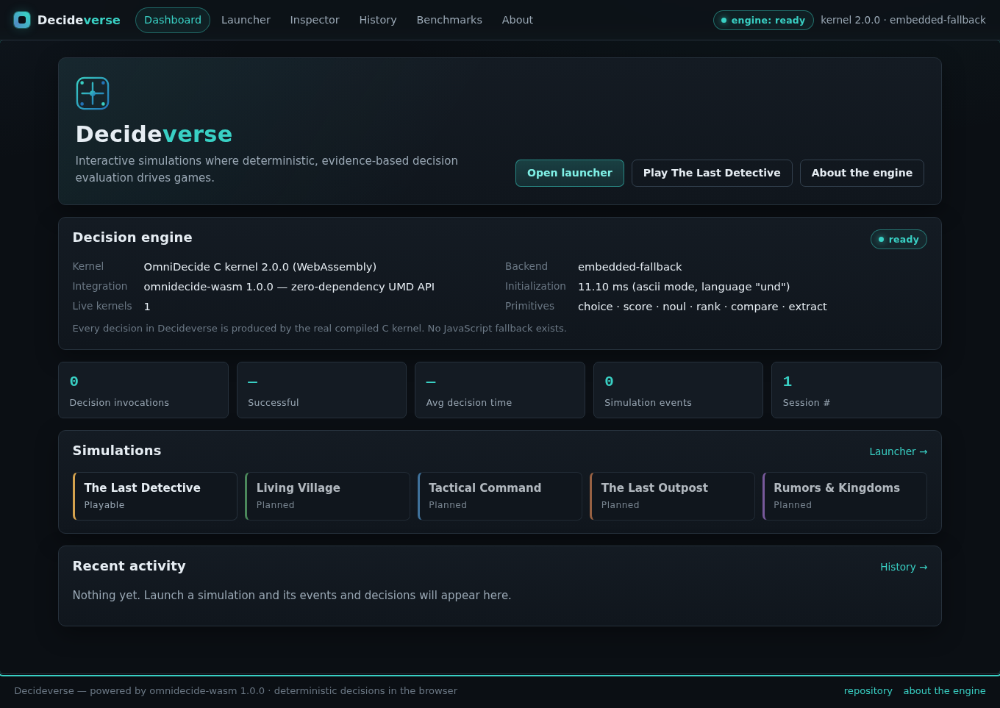

<!-- SPDX-License-Identifier: Apache-2.0 -->
<!-- SPDX-FileCopyrightText: 2026 Tamer Osman -->

# Decideverse — Stage 2

**A browser-based simulation and decision-making laboratory built on the real
OmniDecide WebAssembly kernel** (`omnidecide-wasm-1.0.0`, kernel 2.0.0).

Decideverse turns the verified Stage 1 WASM foundation into an interactive
product: a growing collection of games share one simulation framework and one
decision engine. Stage 2 ships **The Last Detective** as the first complete
playable module; the other four are presented as planned scopes, never as
fake playables.

> Branding note: the product is named **Decideverse** (formerly
> "OmniDecide GameLab"). The `gamelab/` directory, internal module
> identifiers and CI job names intentionally keep the `gamelab` identifier
> for stability.



## Quick start

```bash
# from the repository root — serve over HTTP (file:// is not supported)
python3 -m http.server 8000

# open the laboratory
#   http://127.0.0.1:8000/gamelab/index.html
```

Requirements: any modern browser (Chromium 143 verified) with WebAssembly and
`TextDecoder`. No build step, no bundler, no npm install for the application
itself — Decideverse is plain ES modules plus CSS, staying consistent with the
zero-dependency philosophy of the project. The old Stage 1 playground remains
available at `/web/index.html`.

## What you can do

| Area | Route | Content |
|---|---|---|
| Dashboard | `#/dashboard` | Decideverse identity, live engine status, real decision statistics, recent activity |
| Launcher | `#/launcher` | Five games; The Last Detective playable, four planned scopes |
| Simulation workspace | `#/sim/detective` | Case briefing → investigation → accusation → resolution, with event feed, actors, world status, performance |
| Decision Inspector | `#/inspector` | Every actual kernel invocation: submitted input, engine output, game interpretation |
| Activity History | `#/history` | Chronological events and decisions, filterable, linked to the inspector |
| Benchmark Overview | `#/benchmarks` | Live session measurements only — invocations, min/avg/max ms, samples |
| About & Settings | `#/about` | What the engine is (and is not), versions, working settings (mode/language re-create the kernel) |

## The Last Detective — 60-second walkthrough

1. Open `#/sim/detective`, press **Open case file — start session**.
2. Read the case briefing (seed is configurable, default `20261108`), press
   **Begin investigation**.
3. Spend nine investigation hours across five museum locations. Every finding
   enters the evidence ledger — the exact texts later submitted to the kernel.
4. **Consult OmniDecide** at any time: each consultation is a real WASM call
   (`choice`, `compare`, `noul`, `extract`, `rank`) shown live in the Decision
   Inspector. Following a recommended lead grants +1 hour — a transparent rule,
   never an override.
5. Accuse. The **scenario**, not the engine, decides who is guilty; with the
   full ledger the engine's `rank` genuinely puts the culprit first.
6. **Reset** and **Replay run**: the recorded sequence is re-executed through
   the pure reducer and the real engine — envelopes come back byte-identical.

## Documentation

| Document | Content |
|---|---|
| [`docs/ARCHITECTURE.md`](docs/ARCHITECTURE.md) | Component map, directory structure, data flow |
| [`docs/ADAPTER.md`](docs/ADAPTER.md) | The OmniDecide adapter: lifecycle, validation, timing, errors |
| [`docs/SIMULATION-FRAMEWORK.md`](docs/SIMULATION-FRAMEWORK.md) | Sessions, clock, RNG, events, history, telemetry |
| [`docs/GAME-MODULES.md`](docs/GAME-MODULES.md) | How to register and build a new game module |
| [`docs/LAST-DETECTIVE.md`](docs/LAST-DETECTIVE.md) | Scenario design, decision moments, replay semantics |
| [`docs/TESTING.md`](docs/TESTING.md) | Stage 2 test suites + how to run everything |
| [`docs/LIMITATIONS.md`](docs/LIMITATIONS.md) | Honest limitations of engine and application |
| [`docs/ROADMAP.md`](docs/ROADMAP.md) | The four planned games and suggested stage order |
| [`../docs/GAMELAB.md`](../docs/GAMELAB.md) | Stage 2 entry point + stage 2 report |

## Repository layout (Stage 2 additions)

```
gamelab/                      the application (this directory)
├── index.html                SPA shell; loads dist loader → js API → GameLab
├── styles/                   gamelab.css (design system) + detective.css
├── js/
│   ├── main.js               bootstrap, hash router, navigation
│   ├── core/                 eventbus, clock, rng, adapter, history,
│   │                         telemetry, registry, session, workspace, dom
│   ├── views/                dashboard, launcher, simulation, inspector,
│   │                         history, benchmarks, about
│   └── games/
│       ├── index.js          the five registry entries
│       └── detective/        scenario.js (pure reducer), decisions.js
│                             (pure request builders), replay.js, module.js (UI)
└── docs/                     the documents above + screenshots
tests/gamelab.test.mjs        Stage 2 Node suite (156 checks, real kernel)
tests/gamelab_browser_check.mjs  Stage 2 Playwright E2E (57 checks)
docs/GAMELAB.md               documentation entry point
```

Stage 1 files (`dist/`, `js/`, `web/`, `src/`, `vendor/`, `scripts/`,
`tests/omnidecide.test.mjs`, `tests/browser_check.mjs`, benchmarks, CI) are
untouched.
