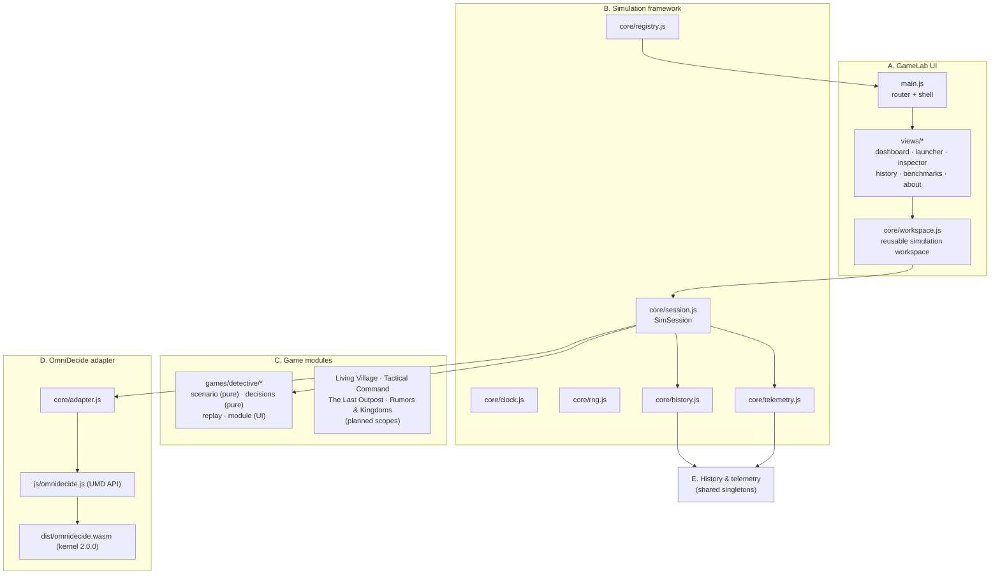

<!-- SPDX-License-Identifier: Apache-2.0 -->
<!-- SPDX-FileCopyrightText: 2026 Tamer Osman -->

# GameLab Architecture

## Component map

GameLab separates five concerns. Each maps to concrete modules; nothing is a
grab-bag.



## Directory structure

```
gamelab/
├── index.html                  shell; script order is contractual:
│                               1. ../dist/omnidecide.js  (Emscripten loader)
│                               2. ../js/omnidecide.js    (UMD API → window.OmniDecide)
│                               3. js/main.js             (ES module app)
├── styles/gamelab.css          design system (tokens, shell, panels, views)
├── styles/detective.css        game-specific interface styles
└── js/
    ├── main.js                 hash router (#/dashboard, #/launcher,
    │                           #/sim/:gameId, #/inspector, #/history,
    │                           #/benchmarks, #/about), topbar engine pill,
    │                           window.__GAMELAB__ test hook
    ├── core/
    │   ├── eventbus.js         pub/sub; subscriptions return unsubscribe fns
    │   ├── dom.js              el() builder, formatting helpers, now()
    │   ├── clock.js            deterministic SimClock (explicit ticks only)
    │   ├── rng.js              mulberry32 + deriveSeed (deterministic streams)
    │   ├── adapter.js          THE engine boundary (see ADAPTER.md)
    │   ├── history.js          ring-buffered events + decisions store
    │   ├── telemetry.js        runtime measurement aggregates
    │   ├── registry.js         game definitions (playable / planned)
    │   ├── session.js          SimSession: binds a game run to the framework
    │   └── workspace.js        workspace frame; mounts game instance
    ├── views/                  one module per route, mount/unmount hygiene
    └── games/
        ├── index.js            registers 1 playable + 4 planned modules
        └── detective/
            ├── scenario.js     PURE reducer: state, rules, evidence, endings
            ├── decisions.js    PURE request builders + interpretation texts
            ├── replay.js       replay runner (invoke fn injected)
            └── module.js       workspace UI + controller
```

## Data flow of one decision

1. The player triggers a review action in the game UI (`module.js`).
2. A **pure builder** (`decisions.js`) produces the exact request object and
   the game's declared interpretation from the current scenario state.
3. `session.decide(request, info)` stamps game/step/label metadata and calls
   `adapter.invoke()`.
4. The adapter validates the request shape, measures `performance.now()`,
   calls `kernel.evaluateRaw(request)` — the **real WASM kernel** — and parses
   the C-authored envelope string.
5. The normalized record (`request`, `raw`, `envelope`, `ok`/`error`,
   `durationMs`, `interpretation`) lands in history + telemetry and is emitted
   on the bus.
6. The game applies the envelope through the reducer
   (`applyConsultationResult` / `applyDecisionResult`), records feed events,
   and re-renders. Objective rules stay in the reducer; the engine result is
   used only through declared, transparent rules.

## Deliberate design decisions

- **No framework, no build step.** The host project is zero-dependency; GameLab
  stays compatible (plain ES modules, CSS, inline SVG icons).
- **Purity boundary.** `scenario.js` and `decisions.js` import nothing from the
  UI or adapter — they run unchanged in Node tests and in the browser, which is
  what makes deterministic replay possible.
- **One engine handle.** The Emscripten module loads once per page; GameLab
  keeps one kernel handle, re-created only when settings change or after an
  explicit shutdown. `engineCount()` is shown in the UI for leak diagnostics.
- **Session persistence across navigation.** The sim route keeps the live
  session in a module-level map, so users can inspect decisions/history
  without killing a run. Navigating away unmounts panels and detaches bus
  listeners (no leaks); returning auto-resumes.
- **Ring buffers.** History caps events (600) and decisions (300) so long
  sessions cannot grow memory unbounded; telemetry keeps only aggregates plus
  the last 64 duration samples.
- **Test hook.** `window.__GAMELAB__` exposes adapter/bus/routes (mirrors the
  Stage 1 `__OD_APP__` pattern) for browser verification.
