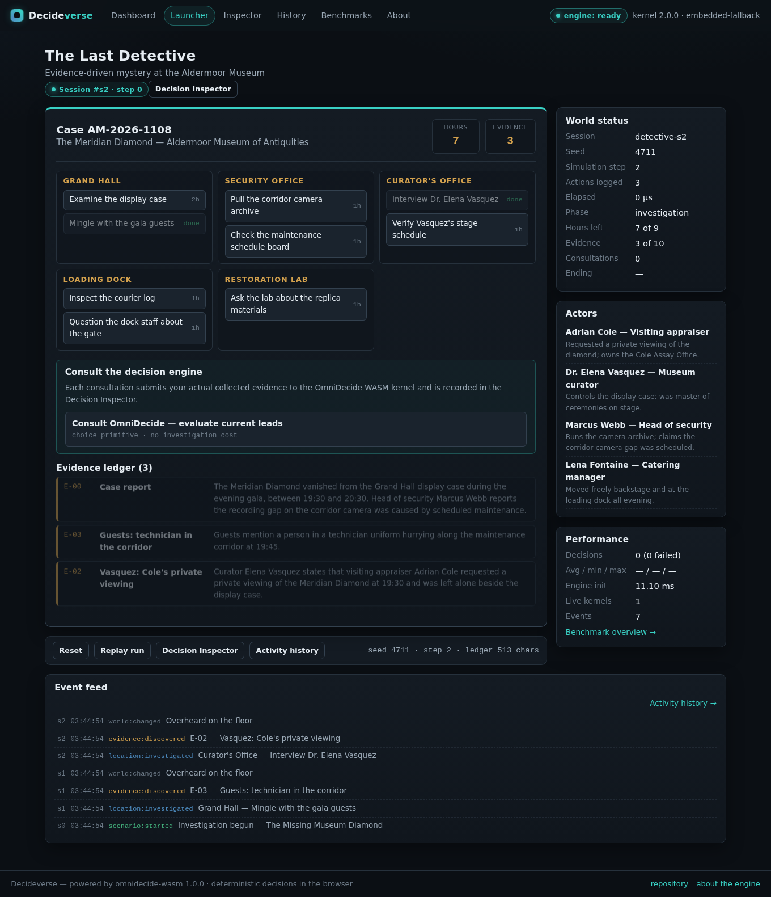
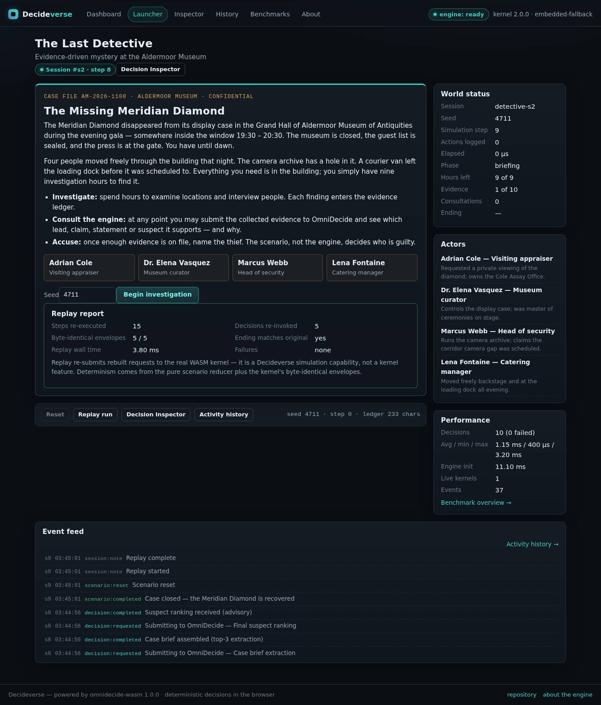

<!-- SPDX-License-Identifier: Apache-2.0 -->
<!-- SPDX-FileCopyrightText: 2026 Tamer Osman -->

# The Last Detective — Gameplay and Scenario Design

## Overview

**Case AM-2026-1108 — The Missing Museum Diamond.** The Meridian Diamond
vanished from its display case in the Grand Hall of the Aldermoor Museum of
Antiquities during the evening gala (window 19:30–20:30). The player is the
investigator with **nine investigation hours**, five locations, four suspects
and a decision engine on call.

The scenario is fully deterministic (default seed `20261108`, configurable on
the briefing screen; non-numeric input falls back to the default and any
number is normalized to its unsigned 32-bit value — Stage 2.1 rules). The
selected seed is written to the authoritative session (`setSeed`), so the
workspace display, the scenario state, reset and replay all use the same
value. The same seed and the same action sequence reproduce the
same evidence, the same events, the same engine envelopes and the same ending.

## Cast

| Suspect | Role | Notes |
|---|---|---|
| **Adrian Cole** | Visiting appraiser | requested a private viewing; owns the Cole Assay Office — *the actual culprit, defined by scenario logic* |
| Dr. Elena Vasquez | Museum curator | controls the display case; master of ceremonies on stage |
| Marcus Webb | Head of security | runs the camera archive; claims the corridor camera gap was scheduled |
| Lena Fontaine | Catering manager | moved freely backstage and at the loading dock |

## Locations and investigation actions

Nine hours, ten actions (9 hours of content) — prioritization is mandatory;
an engine-granted bonus hour can make a full-information run possible.

| Location | Action | Cost | Evidence |
|---|---|---|---|
| Grand Hall | Examine the display case | 2h | E-04 resin replica |
| Grand Hall | Mingle with the gala guests | 1h | E-03 technician in corridor |
| Security Office | Pull the corridor camera archive | 1h | E-01 recording gap 19:38–19:52 |
| Security Office | Check the maintenance schedule board | 1h | E-07 no authorized maintenance |
| Curator's Office | Interview Dr. Elena Vasquez | 1h | E-02 Cole's private viewing at 19:30 |
| Curator's Office | Verify Vasquez's stage schedule | 1h | E-08 stage alibi 19:35–20:05 |
| Loading Dock | Inspect the courier log | 1h | E-05 parcel signed by Cole 20:15 |
| Loading Dock | Question the dock staff about the gate | 1h | E-06 Fontaine saw Cole in uniform 20:10 |
| Restoration Lab | Ask the lab about the replica materials | 1h | E-04b replica is fresh |

The evidence ledger starts with **E-00** (the case report, including Webb's
"scheduled maintenance" claim). Every evidence `text` is written to be
submitted to the kernel **verbatim** — what the player collected is exactly
what the engine evaluates.

## Decision moments (all real kernel calls)

| Review | Primitive | Available when | Engine request | Influence on the game |
|---|---|---|---|---|
| Consult OmniDecide — evaluate current leads | `choice` | ≥ 3 evidence, max 3/case | "Which investigation lead is best supported by the evidence currently collected?" over the currently available actions, context = ledger | If the player's **next action matches the recommended lead**, the museum director grants **+1 hour** (max 2/case). Transparent, visible in the feed, never overrides outcomes. |
| Weigh the conflicting statements | `compare` | E-01 collected | Webb's "authorized it himself" vs the board's "no authorized maintenance", context = ledger | Advisory badge. Whether the gap was authorized is settled by E-07; a `tie` verdict is shown honestly ("weigh them yourself"). |
| Verify the courier claim | `noul` | E-05 collected | "The loading dock courier log records a parcel signed by Adrian Cole." | Advisory true/false; E-05 remains the objective fact either way. |
| Assemble the case brief | `extract` (topK 3) | ≥ 6 evidence | "Which evidence items most directly implicate the culprit?" | The extracted snippets are displayed; nothing is created or removed. |
| Request a suspect ranking | `rank` | ≥ 6 evidence | "Rank the suspects by how strongly the collected evidence implicates them…" over the four names | Advisory ranking. With the complete ledger the kernel genuinely puts **Adrian Cole** first (confidence ≈ 0.03 — the UI shows the number honestly). |

Every invocation is recorded (request, raw envelope, parsed envelope, duration,
interpretation) and inspectable in the Decision Inspector.

## Endings

- **Accuse Adrian Cole** → *Case closed — the Meridian Diamond is recovered.*
  Cole is arrested at the assay office; the parcel holds the diamond.
- **Accuse anyone else** → *Case closed — wrong arrest.* The prosecution
  collapses; the real culprit is revealed.
- **Close the case unsolved** → *The case went cold.*
- Accusation unlocks at ≥ 6 evidence items (E-00 + 5). The ending is decided
  **only** by scenario logic — accusing Cole wins even if the player never
  consulted the engine once (asserted by a dedicated test).

## Reset and replay

- **Reset** snapshots the previous run (seed + full step log + decision
  envelopes + ending) into "last run", rebuilds the initial state from the
  same seed, and logs a `scenario:reset` event. Previous records stay in
  history for inspection. The **effective seed is retained**: session,
  scenario and the workspace display keep showing the same value (Stage 2.1
  seed ownership). The shared action counter starts a new run at **0** —
  reset semantics are documented in SIMULATION-FRAMEWORK.md.
- **Replay run** re-executes the snapshot through the **pure reducer** with
  the recorded effective seed. Decision requests are rebuilt by the pure
  builders and **genuinely re-submitted** to the real WASM kernel (marked
  `[replay] …` and cross-linked via `replayOf`). Kernel determinism then
  yields byte-identical envelopes; the replay report shows
  `identical/compared`, whether the ending matches, and the wall time.
  Replay is a GameLab simulation capability — the kernel API has no replay
  feature, and the UI says so. Replay never appends to the shared action
  counter.

## Two logs, two purposes (Stage 2.1)

- The game's `runLog` is the **faithful input sequence** of a run:
  briefing, investigation actions, decision submissions (including attempts
  the engine rejected, so replay can re-submit them byte-faithfully),
  accusation, unsolved close. This is what replay re-executes.
- The shared `session.actionLog` counts **successful player actions only**
  (begin, investigate, accepted decide, accuse, close-unsolved) and is what
  the workspace "Actions logged" counter renders. Rejected commands and
  failed engine invocations never enter it. The two records agree except by
  exactly the number of failed decision attempts (documented, tested).

## Why the engine "works" here

The evidence texts are authored so that lexical evidence matching — which is
all the kernel does — aligns with the scenario truth once the player has done
the legwork: the culprit's name and actions dominate the ledger. No result is
hardcoded and no winner is forced: change the evidence you submit and the
engine's answer changes with it, exactly as it should.
